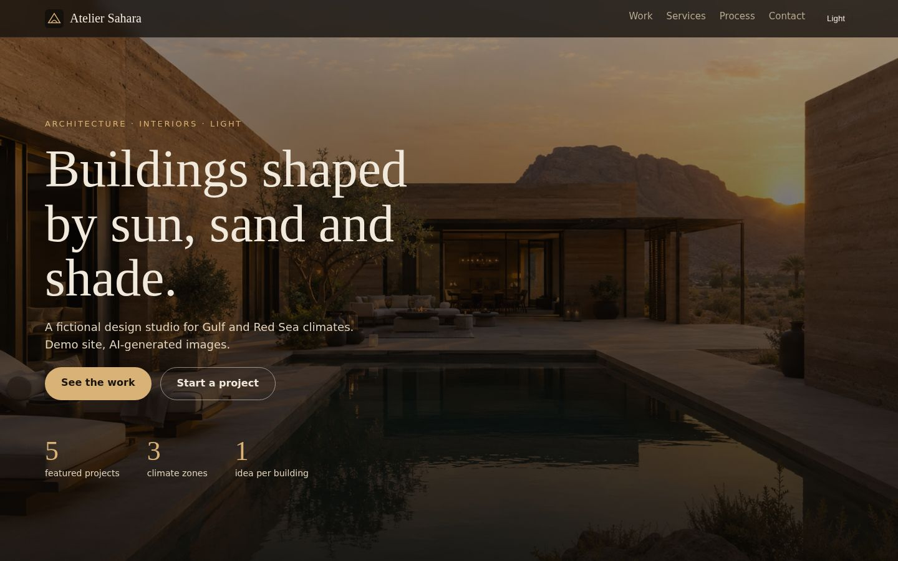
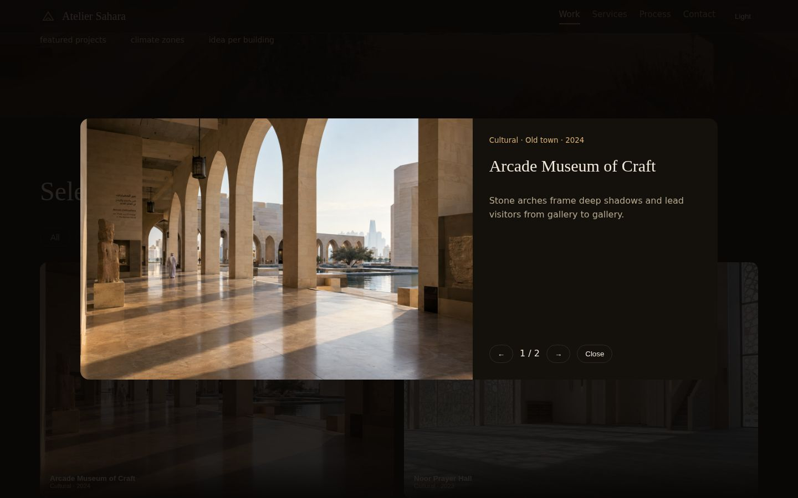
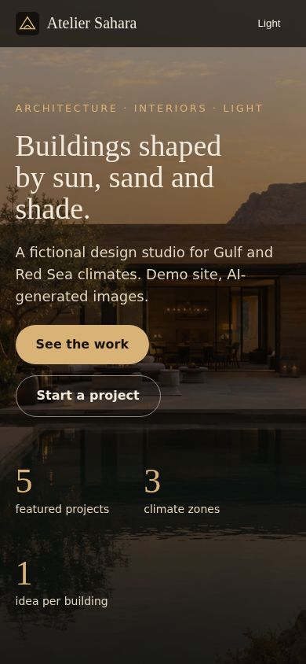

# Atelier Sahara (React + Vite)

A website demo for a fictional architecture studio working in Gulf and Red Sea climates. The studio, projects and text are invented. All images are AI-generated.

## Features
- Dark and light theme, saved in the browser
- Project gallery with type filter and a lightbox (arrow keys, Esc, wrap-around)
- Services and process sections, scroll-aware navigation
- Inquiry form with field validation (demo only, nothing is sent)
- Responsive down to 390 px wide

## Run
```bash
npm install
npm run dev      # development
npm run build    # production build in dist/
```

## Preview




## Tests
Checked in headless Chrome: gallery filter, lightbox keyboard navigation, theme persistence, form validation, no horizontal overflow on mobile, no console errors.
